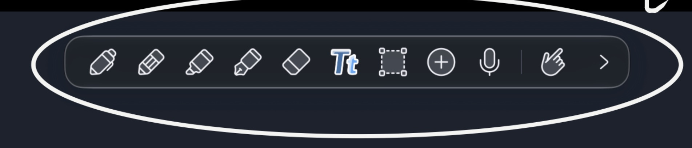
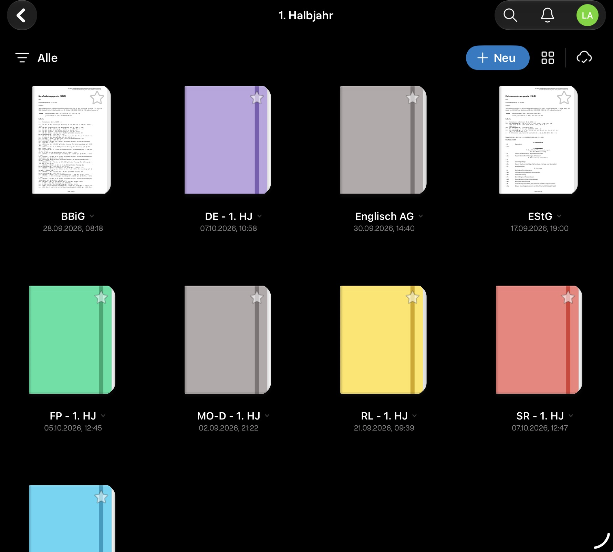
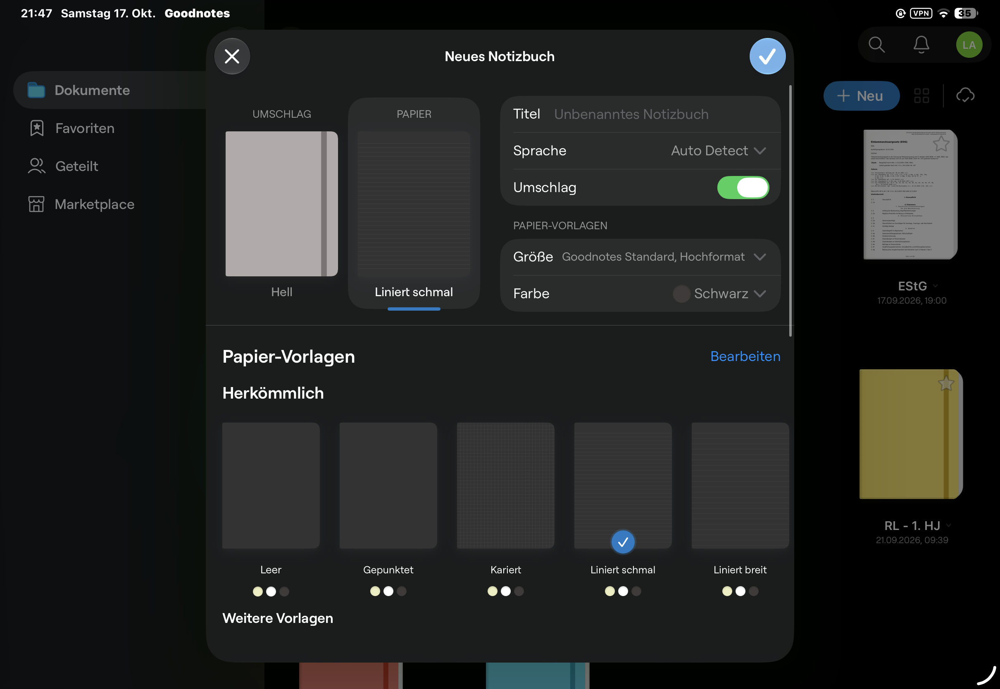
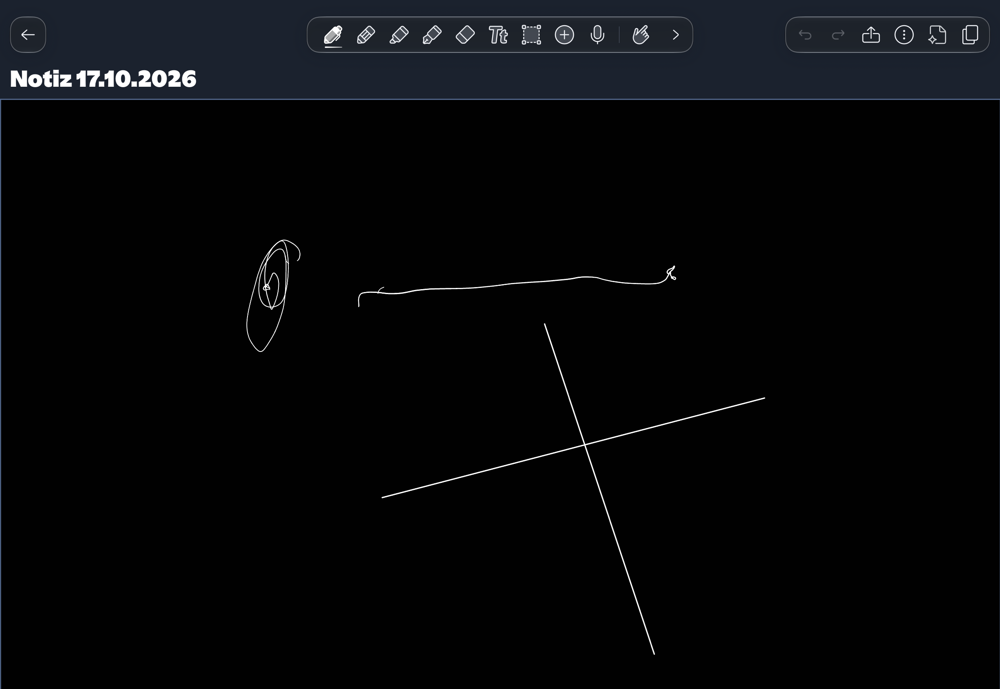
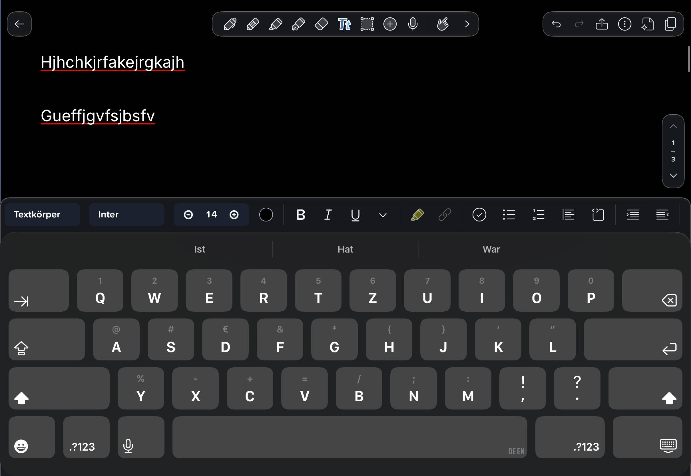
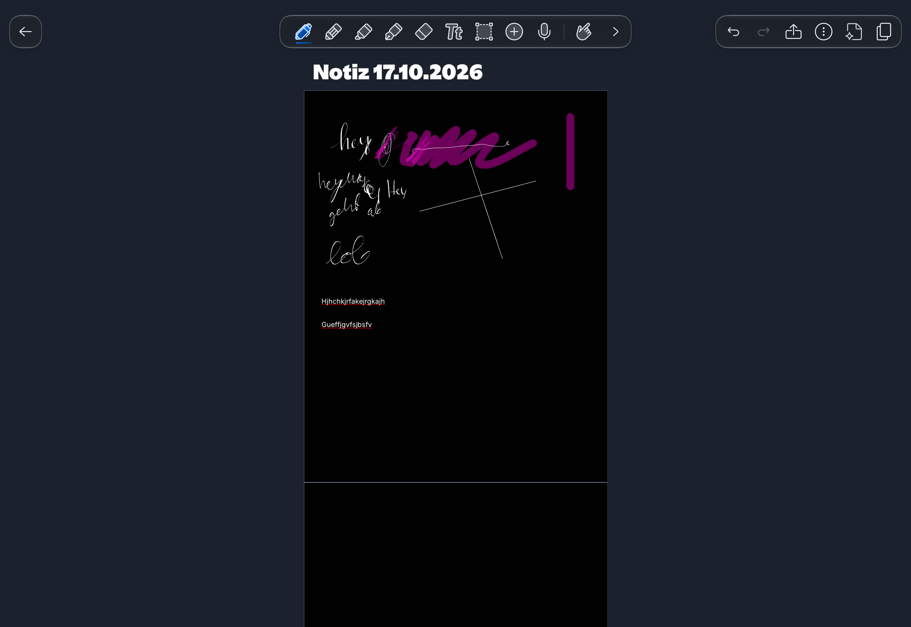
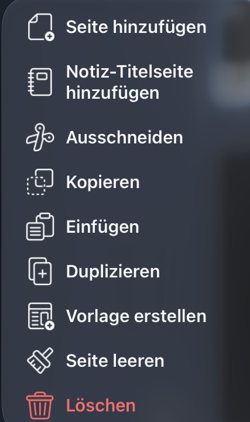
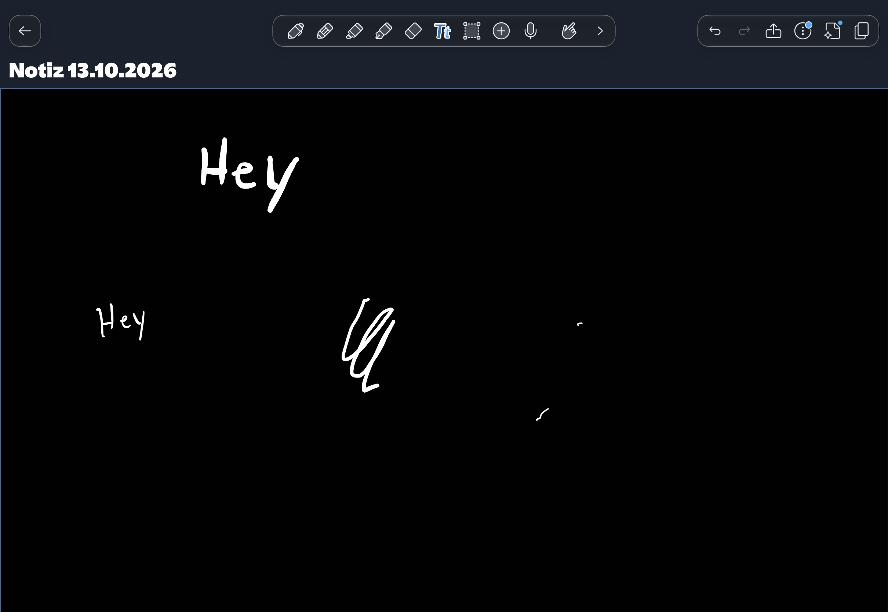

# Noty – Vorgaben für den UI-Rebuild

## Texteditor und zusätzliche Schreibseite – Build 27

Seitensprünge/helle Tastatur gemeldet; neue Referenzen IMG_0248–0251 und automatische Fortsetzung auf Folgeseiten ausdrücklich bestätigt. Papier-/Randtext ohne Feldleisten, freie PDF-Felder, dunkle Tastatur und Formatierung über der Tastatur. Virtuelle letzte Schreibseite vor erster Texteingabe oder erstem Pencil-Strich außerhalb von Heft/Export/Seitenzahl. Umsetzung, Quellen, ursprüngliche Fehlergrenzen und gemeinsamer Gerätetest in [TEXT-REBUILD-27](history/TEXT-REBUILD-27.md); [Build-/Archiv-/Updatebelege](TESTING.md). Bisherige Textvorgaben aus Build 21 damit in diesem Punkt ersetzt.

Stand: 18.10.2026. Zusammenfassung der Ideen aus „Noty github.md“ im Obsidian Vault und der zugehörigen Bildreferenzen, einschließlich der anschließend bestätigten Antworten zu Textfeldern, Formatierung, Umschlag, Seitennavigation, Ausschneiden, Einfügen, Leeren, Autostift und Pencil-Vorschau. Dieses Dokument beschreibt das gewünschte Ergebnis, keinen bereits implementierten oder getesteten Stand. Die konkrete Werkzeugaufteilung wurde anschließend ebenfalls vom Nutzer bestätigt. Die Gesetzessammlung bleibt eine spätere Erweiterung.

## Gestaltungsziel

Noty soll sich wie ein persönliches digitales Schulnotizbuch anfühlen. Die Seite steht im Mittelpunkt; Bedienelemente brauchen möglichst wenig Platz. Die bestehende glasige Gestaltung bleibt erhalten.

Die Screenshots dienen als Referenz für Anordnung und Bedienung. Sie sind keine Vorlage zum vollständigen Kopieren: Nur die hier beschriebenen Funktionen übernehmen. Insbesondere begründen Mikrofon-, Account- oder andere Symbole in den Bildern keine zusätzlichen Funktionen.

## UI-Rebuild

### 1. Werkzeugleiste: andockbar und frei schwebend

- Eine kompakte, abgerundete Werkzeugleiste im bisherigen Glasstil verwenden.
- Vier Andockpositionen anbieten: oben und unten horizontal, links und rechts vertikal.
- Die Leiste per Ziehen zwischen diesen Positionen verschieben können. Standardmäßig nur an diesen vier Dockpunkten platzieren; freies Platzieren in den Einstellungen ausdrücklich freischalten (Präzisierung Build 24).
- Bei freigeschaltetem freien Platzieren durch Wegziehen vom Rand in einen frei schwebenden Zustand wechseln; durch Zurückziehen an eine Andockposition wieder befestigen.
- Die Referenzen zeigen die gewünschte kompakte Anordnung und den Zugriff auf weitere Werkzeuge. Die folgende Aufteilung wurde anhand der Bilder und vorhandenen Noty-Funktionen vorgeschlagen und vom Nutzer bestätigt.

#### Bestätigte Aufteilung

Die Hauptleiste enthält standardmäßig in dieser Reihenfolge:

1. **Stift:** normales Schreiben; Farbe, Breite, Autostift und Halteerkennung über die Werkzeugeinstellungen.
2. **Textmarker:** Markieren mit eigener Farbe und Breite.
3. **Radierer:** zuletzt gewählter Radiermodus; Ganzstrich- und Präzisionsradierer in den Werkzeugeinstellungen wechseln.
4. **Text:** freie Textfelder anlegen und bearbeiten.
5. **Lasso:** gemischte Auswahl; Handschrift, Text, Bilder und Formen über Typfilter ein-/ausschließen.
6. **Formen:** Gerade, Pfeil, Rechteck und Ellipse; Art, Strichmuster und Füllung in den Werkzeugeinstellungen.
7. **Bild einfügen (+):** Fotos/Screenshots, Bilddatei oder Bild aus der Zwischenablage wählen.
8. **Lesemodus (Hand):** PDF-Text auswählen/kopieren und navigieren.
9. **Weitere (Pfeil):** die zweite Werkzeugebene öffnen.

Auf der **zweiten Ebene** liegen Lineal, die vorhandene reine Handschriftauswahl, „Seitenbreite einpassen“, Inhaltssuche, zweite Dokumentansicht und „Werkzeugleiste anpassen“. Derselbe Pfeil bleibt am rechten Ende und dreht sich beim Umschalten; so führt er auch wieder zur Hauptleiste. Bei vertikaler Anordnung bleibt die Reihenfolge von oben nach unten erhalten.

Ein Werkzeug durch Antippen aktivieren; erneutes Antippen öffnet seine Einstellungen als kleine angehängte Leiste. Farbe, Breite und Untermodi dort bündeln, damit sie die Hauptleiste nicht dauerhaft verbreitern. Unter „Werkzeugleiste anpassen“ Reihenfolge und Lieblingsstifte verwalten und Favoriten direkt zugänglich machen; dort auch Fingermalen und Pencil-Vorschau umschalten.

**Rückgängig/Wiederholen** oben rechts zusammen mit Optionen, „Neue Seite“ und Seitenübersicht platzieren. PDF-Import über „Neue Seite“, Export über die Optionen erreichbar machen. So bleibt die bewegliche Werkzeugleiste auf Schreiben und Bearbeiten ausgerichtet.

### 2. Notizbücher und Erstellen-Dialog

Das Notizbuch bleibt das zentrale Element von Noty. In der Übersicht sollen die Hefte mit ihrem gewählten Umschlag erkennbar sein.

Beim Erstellen eines Notizbuchs folgende Einstellungen gemeinsam anbieten:

- Titel.
- Umschlag ein-/ausschalten und Umschlagfarbe wählen.
- Papiergröße, Papierfarbe und Papiervorlage wählen.
- Die Papierauswahl als Standard für neue Papierseiten dieses Notizbuchs speichern.

Umschlag und Papier getrennt behandeln. Der Umschlag ist ausschließlich die Darstellung des Hefts in der Bibliothek. Er erzeugt keine zusätzliche Seite, verändert die Seitenzahl nicht und wird nicht als Seite in den PDF-Export aufgenommen. Die Bilder zeigen die gewünschte Darstellung der Hefte sowie die Zusammenstellung des Erstellen-Dialogs; zusätzliche Angebote aus der Referenz gehören nicht automatisch dazu.

### 3. Editor: mehr Platz für die Seite

- Eine ruhige Oberfläche mit möglichst großer sichtbarer Schreibfläche gestalten.
- Oben links den Zurück-Pfeil anzeigen, direkt daneben den Notizbuchnamen.
- Den Namen bei Platzmangel mit „…“ kürzen, bevor er in die Werkzeugleiste hineinragt.
- Oben rechts Optionen, „Neue Seite“ und den Zugang zur Seitenübersicht platzieren.
- Die vorhandene Seitenübersicht weiterverwenden und gezielt ergänzen.
- Gegenüber der Referenz die zusätzliche hohe Titelzeile einsparen: Der Name gehört neben den Zurück-Pfeil.

### 4. Textwerkzeug und Formatierung

Die Referenz zeigt die gewünschten Formatierungsfunktionen. Klar erkennbar sind Textstil, Schriftart, Schriftgröße, Textfarbe, Fett, Kursiv, Unterstrichen, Hervorhebung, Link, Checkliste, Aufzählung, Nummerierung, Ausrichtung und Einzüge. Die genaue Belegung weiterer Symbole muss bei Bedarf geklärt werden.

Neue Textfelder beginnen standardmäßig links auf der Seite und nutzen anfangs die Seitenbreite. Es bleiben freie Textfelder: Sie lassen sich anschließend verschieben und in der Breite verändern; mehrere Felder pro Seite sind weiterhin möglich. Die Formatierungsleiste orientiert sich an der Referenz oberhalb der Bildschirmtastatur. Text bleibt innerhalb der jeweiligen festen Seite; daraus entsteht kein automatischer Fließtext über mehrere Seiten. Bereits vorhandene Textfelder behalten ihre gespeicherte Position und Breite.

Einzelne markierte Wörter und Abschnitte innerhalb desselben Feldes unterschiedlich formatieren können, beispielsweise nur ein Wort fett setzen oder einen Abschnitt anders einfärben. Ein gemeinsamer Stil für das gesamte Feld genügt für das gewünschte Ergebnis nicht. Gemischte Formatierungen beim Speichern/Neustart, Kopieren/Duplizieren, in Backups, Vorschauen und PDF-Export erhalten. Dies ist eine Erweiterung gegenüber dem bisher dokumentierten Textpaket mit Stil pro vollständigem Feld.

### 5. Seitenansicht und Navigation

- Seiten standardmäßig auf die verfügbare Breite einpassen. Gemeint ist die Startansicht; manuelles Zoomen bleibt möglich.
- Das Dokument auch nach links und rechts verschieben können; ab Build 23 je Seite 65 % der Editorbreite als seitlichen Spielraum vorsehen. Startansicht weiterhin mittig eingepasst.
- Notizbuchseiten standardmäßig untereinander anzeigen und vertikal durchscrollen lassen. Auch teilweise sichtbare vorherige/folgende Seiten mit ihren vollständigen Ebenen laden; nicht nur die ausgewählte Seite.
- Zusätzlich einen umschaltbaren Blättermodus anbieten: mit dem Finger nach links bzw. rechts zur vorherigen oder nächsten Seite wechseln.
- Unten rechts ein kleines Navigationselement anzeigen. Seine Elemente stehen von oben nach unten: Pfeil nach oben, aktuelle Seitennummer, Trennstrich, Gesamtseitenzahl, Pfeil nach unten.
- Der obere Pfeil öffnet die vorherige Seite, der untere die nächste Seite.

Die Referenz veranschaulicht die Seitenansicht. Die gewünschte Standardansicht bleibt ausdrücklich auf Seitenbreite, auch wenn das Bild eine weiter herausgezoomte Ansicht zeigt. Das Navigationselement ist im Screenshot des Textwerkzeugs sichtbar; die gewünschte Position ist unten rechts.

### 6. Seitenmanager: Synchronisierung und Seitenmenü

- Die Seitenübersicht rechts öffnen. Bei breitem Fenster rechts Platz reservieren, bei schmalem Fenster von rechts über den Editor einblenden. Diese Präzisierung vom 18.10.2026 ersetzt die frühere linke Anordnung.

- Beim Scrollen im Dokument die Vorschauen im Seitenmanager zur aktuellen Seite mitführen.
- Bloßes Scrollen durch die Vorschauen verändert die im Editor geöffnete Seite nicht.
- Antippen einer Vorschau öffnet weiterhin die entsprechende Seite im Editor.

Im Menü einer einzelnen Seite diese Aktionen in dieser Reihenfolge anbieten:

1. **Seite hinzufügen:** Eine neue Seite direkt nach der ausgewählten Seite anlegen.
2. **Ausschneiden:** Die Seite zum Verschieben vormerken. Sie bleibt zunächst an ihrer bisherigen Position und wird erst beim erfolgreichen Einfügen an die neue Position verschoben. Ohne Einfügen bleibt die ursprüngliche Seite erhalten.
3. **Kopieren:** Die Seite kopieren; das Original bleibt erhalten.
4. **Einfügen:** Eine kopierte Seite als eigenständige Kopie einfügen oder eine zum Ausschneiden vorgemerkte Seite verschieben. In beiden Fällen landet die Seite immer direkt nach der ausgewählten Seite.
5. **Duplizieren:** Eine eigenständige Kopie der ausgewählten Seite erzeugen.
6. **Seite leeren:** Eigene Inhalte wie Handschrift, Text, eingefügte Bilder und Formen entfernen. Das Quell-PDF und das Papier einschließlich Papiervorlage bleiben erhalten.
7. **Löschen:** Die ausgewählte Seite über den bestehenden Seitenpapierkorb löschen.

„Vorlage erstellen“ und „Notiz-Titelseite hinzufügen“ werden aktuell nicht benötigt und erscheinen deshalb nicht in diesem Menü. Der optionale Umschlag beim Erstellen eines Notizbuchs bleibt davon getrennt.

## Weitere Funktionsideen

### Autostift

Der Autostift wählt die Farbe anhand der hellen oder dunklen Papier- bzw. PDF-Seite: auf hellen Seiten schwarz, auf dunklen Seiten weiß. Die Wahl erfolgt pro Seite und gilt nur für neue Striche. Vorhandene Striche behalten ihre gespeicherte Farbe, auch bei einem späteren Hintergrundwechsel.

### Einfacher PDF-Import und zusätzlicher Schreibplatz

- Arbeitsblätter, die vorher in der Dateien-App gescannt wurden, einfach als PDF importieren können.
- Zusätzlichen Platz für Notizen oder Lösungen optional bereits beim Import ergänzen können.
- Diesen Schreibplatz nach dem Import weiterhin zuverlässig ändern können.
- Bestehende Inhalte und die Originalgröße des PDFs erhalten; vorhandene Randfunktionen dafür weiterverwenden.

### Pencil-Vorschau umschalten

Die Vorschau bzw. Markierung unter dem schwebenden Apple Pencil ein- und ausschalten können. „Stiftschatten“ bezeichnet in der ursprünglichen Idee diese Vorschau.

## Zu beheben

Beim Drehen von Bildern soll das Bildwerkzeug an geraden Winkeln einrasten: 0°, 90°, 180° und 270°. Damit lassen sich Bilder zuverlässig gerade ausrichten.

## Spätere Idee: Gesetzessammlung in Noty

Die eigene Website [law.xclipsen.de](https://law.xclipsen.de) später direkt innerhalb der App nutzen können. Zugehöriges lokales Projekt: `/home/la/workspace/gesetzessammlung`.

- Die Integration ausdrücklich in den Einstellungen aktivieren; in der ursprünglichen Idee als „Account-Einstellungen“ bezeichnet. Ein zusätzliches Noty-Konto ist damit noch nicht beschlossen.
- Eine Ansicht neben der Notiz und alternativ eine seitlich eingeblendete Ansicht innerhalb der App anbieten.
- Die Bedienung für die Bildschirmtastatur optimieren. Bei der Suche nach einer Paragraphennummer eine kleine Zahlentastatur anzeigen.
- Eine Schnellsuche wie `144 HBG` soll unmittelbar den passenden Paragraphen im angegebenen Gesetz öffnen. Die Schreibweise stammt aus der Idee; das konkrete Gesetzeskürzel ist vor Umsetzung zu bestätigen.

Diese Integration ist eine spätere Erweiterung und kein Bestandteil des jetzigen UI-Rebuilds.

## Vor der Umsetzung abgleichen

Die Rückfragen zu Textfeldern, Formatierung, Umschlag, Seitennavigation, Ausschneiden, Einfügen, Leeren, Autostift und Pencil-Vorschau sind beantwortet und oben eingearbeitet. Auch die vorgeschlagene Werkzeugaufteilung ist bestätigt. Fragen zur späteren Gesetzessammlung bleiben bis zu deren Planung zurückgestellt.

Die ergänzenden Vorgaben sind auch in [DESIGN.md](DESIGN.md) und [SCOPE.md](SCOPE.md) festgehalten. Insbesondere präzisieren die neuen Vorgaben das Andocken unten, freie Textfelder mit anfangs voller Seitenbreite, gemischte Textformatierung, das automatische Mitführen der Seitenübersicht und den Autostift für neue Striche. Historische Implementierungs- und Testnachweise bleiben als solche erhalten; die Zielvorgaben oben sind kein Implementierungs- oder Gerätenachweis.

## Kopfzeile, Zoom und Trefferflächen – Build 26

Gerätebild IMG_0246 zeigt die unnötige zweite Leistenzeile bei geöffneter rechter Seitenübersicht. Neue Rückmeldungen einschließlich der späteren Präzisierungen:

- Kopfaufteilung anhand tatsächlicher Tastenflächen statt pauschaler 432-pt-Reserve. Bei 1194 pt Gesamtbreite und 320-pt-Übersicht bleiben im 874-pt-Editor alle Hauptwerkzeuge oben, mittig und unverändert breit. Kopfaktionen passen sich an: fünf bei viel Platz, vier einschließlich Undo/Redo/Optionen/Übersicht im gezeigten Fall, drei bei stärkerer Enge. „Seite hinzufügen“ und „Wiederholen“ bleiben zusätzlich im Optionenmenü erreichbar. Bei sehr schmalen Fenstern weiterhin eine eigene Werkzeugzeile, wenn eine nutzbare Leiste oben nicht mehr passt. Ebenenwechsel behält die Kopfaufteilung.
- Werkzeug- und Optionsleiste verwenden exakt denselben `NotyGlass`-Modifier wie der Undo-/Redo-Bereich, einschließlich Systemglas, Material-Fallback und reduzierter Transparenz. Keine eigene andere Glastönung mehr.
- Größere Trefferflächen: Hauptwerkzeuge/Pfeil 48 × 48 pt ohne bisherige tote Zwischenräume; Gesamtlänge und 52-pt-Höhe bleiben gleich. Kopf/Optionsaktionen und kleine Seitenpfeile, Lesezeichen und Schließen mindestens 44 pt. Sichtbare Symbole bleiben kompakt. Bildgriffe 44 pt und ihre Aktionsleiste behalten Bildschirmgröße auch bei Zoom/normalisierter Anzeige; Bildrenderauflösung berücksichtigt ebenfalls den vollständigen Anzeigefaktor.
- Die frühere 70-%-Zoomgrenze ist ersetzt: dauerhaft höchstens bis zum **vollständigen Blatt einschließlich Schreibrändern** herauszoomen. Die native elastische Zoomgeste darf vorübergehend darüber hinaus und federt beim Loslassen auf die Grenze zurück. Grenze bei der nächsten Geste passend zur dann ausgewählten Seite bestimmen; reines Scrollen soll keinen Zoomsprung verursachen.
- Bei Loslassen innerhalb von ungefähr ±8 % der Seitenbreiten-Anpassung animiert auf diese Breite einrasten und horizontal zentrieren. Im Normalisierungsmodus ist dies die Arbeitsblattbreite ohne Schreibraum. Die Vollblattgrenze bleibt separat erreichbar; nach einer elastischen Grenzüberschreitung kein zweites Breiten-Snapping erzwingen. Programmatische Snap-Animationen dürfen sich nicht selbst erneut auslösen.
- Bilddrehung deutlicher magnetisch: Eintritt innerhalb von 8° um 0/90/180/270°, bis 12° halten, außerhalb frei drehen. Grüner Drehgriff und einmalige haptische Rückmeldung beim Einrasten. Der 90°-Knopf richtet auch ein schiefes Bild auf den nächsten exakten Vierteldrehwinkel aus. Quelle/Originalbytes bleiben erhalten.
- Werkzeuge heben sich bei Hover leicht an, erhalten Licht/Schatten und nativen Lift; Hover aktiviert kein Werkzeug und schreibt keine Ink. Bewegung reduzieren unterdrückt das Vergrößern/Anheben. Native Hover- und Zoom-APIs: [Apple Lift](https://developer.apple.com/documentation/swiftui/hovereffect/lift), [Pencil-Hover](https://developer.apple.com/documentation/uikit/adopting-hover-support-for-apple-pencil), [Zoomrechteck](https://developer.apple.com/documentation/uikit/uiscrollview/zoom(to:animated:)), [Zoom-Endcallback und Bounce](https://developer.apple.com/documentation/uikit/uiscrollviewdelegate/scrollviewdidendzooming(_:with:atscale:)). Tatsächliches Pencil-Verhalten am Gerät prüfen.

207 Core-Tests einschließlich neun neuer Kopf-/Zoom-/Drehregressionen bestanden, signierter iPad-SDK-Build erfolgreich und Build 26 am Gerät installiert bestätigt. Notebook-/Werkzeug-/Archivformate unverändert. Frischer Rücklesevergleich: 21 Hefte vollständig gleich; ein Heft nur mit geänderter Handschrift auf Seite 1/2, vom Nutzer als aktuelle eigene Bearbeitung bestätigt. Alle übrigen Inhalte gleich. [Installations- und Bestandsnachweis](TESTING.md).

Noch offener gemeinsamer Gerätetest: Seitenübersicht mehrfach öffnen/schließen; Leiste im gezeigten Querformat oben. Undo/Redo sowie Hinzufügen über Kopf/Optionen, größere kleine Pfeile/Lesezeichen und Werkzeugoptionen prüfen. Ganzes Blatt einschließlich Rand herauszoomen, weiterziehen/loslassen und Rückfederung; nahe Breitenfit loslassen und zentriertes Einrasten, normales stärkeres Vergrößern und gemischte Seiten. Bild an allen Viertelwinkeln frei drehen/einrasten, bewusst lösen, per Knopf gerade stellen und Undo; Griffe in normalisierter Ansicht/verschiedenen Zoomstufen. Pencil-Hover über Werkzeuge ohne versehentliche Wahl/Striche, auch mit reduzierter Bewegung. Optik, Treffergefühl, native Animationen und Haptik bleiben durch Linux-Tests unbelegt.

## Anzeige normalisieren und Leistenreferenzen – Build 25

Nutzer bestätigt ausdrücklich **nur die Anzeige angleichen**, keine dauerhafte Änderung des PDF-/Papierformats. Anlass IMG_0245: stark unterschiedliche PDF-Punktmaße lassen eine Papierseite winzig neben einer großen PDF mit Schreibraum erscheinen. Zwei weitere konkrete Referenzleisten wurden erneut vorgegeben.

**Optionen → „PDFs einheitlich anzeigen“**, optional und zunächst aus. Bei Aktivierung alle Grundseiten in der Scrollfläche auf 595 Anzeigeeinheiten Breite bringen, Seitenverhältnis erhalten. Linke/rechte/obere/untere Schreibränder mit derselben Seitentransformation erhalten; Grundseiten an derselben linken Kante ausrichten. Einpassen/Startposition beziehen sich dann auf das Arbeitsblatt ohne zusätzliche Ränder: Text bleibt auf Bildschirmbreite, Schreibraum daneben durch horizontales Verschieben erreichbar. Erneutes Abschalten stellt die bisherige Darstellung in tatsächlichen Punktmaßen wieder her. Der Blättermodus nutzt dieselbe Darstellung.

Nur die Platzierung ganzer nativer Zeichenflächen im äußeren Viewport wird skaliert. Bounds, Original-PDF, gespeicherte Ink/Text/Bild/Form-Koordinaten, Undo und Exportformate bleiben unverändert. Suche und Caret-/Touchkonvertierung müssen dieselbe Transformation beachten. Kein Rasterisieren, Neucodieren, Strecken oder Beschneiden der Originalquelle. Die Anzeige kann aus einem bereits unscharfen Scan keine zusätzlichen Details gewinnen; das Original bleibt zum Zoomen erhalten.

Beide Leisten nach den neuen Referenzen flacher: 52 statt 60 pt hoch, Innenrand 4 statt 8 pt, 44-pt-Treffflächen bleiben. Konturen 23–26 pt statt 26–29 pt, kleinere Auswahlfläche und feine Gruppentrenner vor Hand/Lesemodus und Anpassung. Glas bleibt dezent grau, Pfeil dauerhaft rechts, Zwei-Reihen-/Drei-Spalten-Griff und Dockbindung aus Build 24 bleiben. Ohne Favoriten Hauptleiste 460 × 52 pt, weitere Ebene mit zweiter Ansicht 364 × 52 pt, ohne diese 316 × 52 pt. Die Bilder erweitern nicht den bestätigten Funktionsumfang um Audio oder zusätzliche Stiftarten.

198 Core-Tests einschließlich acht neuer Fälle zu gemischten Größen/Rotation/Seitenverhältnis, allen Rändern, negativer Suchgeometrie, deaktiviertem Modus, Einpassen ohne Randverkleinerung, unveränderten Original-/Heftbytes, Legacy und Werkzeugmigration bestanden. Werkzeugformat 7 merkt die Ansichtsoption je Bereich; Notebook-Schema 7 und Export bleiben unverändert. Signierter SDK-Build und unabhängiger Archivroundtrip bestanden. Build 25 am Gerät bestätigt, alle 22 Heftinhalte unverändert. SDK-, Archiv- und Installationsnachweise: [TESTING](TESTING.md).

Noch offener Gerätetest: betroffene kleine/große PDF und Papier mit/ohne Schreibrand in beiden Modi vergleichen; Text lesen/zoomen, Rand erreichen, Nachbarseiten/Blättern, Suchtreffer/Caret sowie neue Ink/Text/Bilder/Formen prüfen. Nach Speichern/Neustart Modus und Inhalte kontrollieren. Besonders tatsächliche Lesbarkeit/PDFKit-Auflösung, Touch-/Pencilpositionen und Referenzoptik sind nicht durch Core-Geometrie bewiesen. Geräte-PDF und editierbares Backup später unabhängig vergleichen.

## Präzisierung von Leiste und Blättern – Build 24

Weitere Nutzerkorrekturen vom 18.10.2026:

- Dezentes grau getöntes Glas statt starker Glanzkante. Die blaue Fokuslinie oben vollständig entfernen; auch der Trenner zweier Ansichten neutral grau.
- Werkzeugoptionen nach erneutem Antippen als kompakte angehängte Leiste, nicht als großes Popover: eine 52-pt-Zeile mit Farbe/Breite/Untermodus bzw. Aktionen, bei Bedarf horizontal scrollbar. Standard unter der Hauptleiste, am unteren Bildschirmrand darüber, bei vertikaler Leiste nach innen daneben. Optionen bleiben erreichbar und oben/unten wird Platz reserviert. Bildimport und Textfeldanlage weiter direkt darüber erreichbar.
- Ein einziger dauerhafter Pfeil bleibt rechts am Ende, außerhalb des wechselnden/scrollbaren Inhalts. Er dreht sich beim Umschalten animiert um 180°; vertikal bleibt er am unteren Ende. Kein separater Zurück-Knopf am Anfang der erweiterten Ebene. Ohne Favoriten Hauptleiste weiterhin 468 × 60 pt; weitere Ebene mit zweiter Ansicht 372 × 60 pt, ohne diese 324 × 60 pt. Drehsymbol aus der erweiterten Ebene entfernt.
- Griff aus **zwei Reihen mit je drei Punkten** (letzte ausdrückliche Korrektur des Nutzers). Vier Andockzonen von 180 auf 240 pt verlängern, an kleine Fenster begrenzen.
- **Standardmäßig nur Dockpunkte:** Ohne aktives Ziel springt die Leiste nach dem Loslassen an ihren bisherigen Dockpunkt zurück. In „Werkzeugleiste anpassen“ lässt sich „Nur an Andockpunkten“ ausschalten; erst dann freies Platzieren, schwebende Ausrichtung und Doppeltipp-Drehung zulassen. Alte freie Koordinaten/Ausrichtung erhalten, aber bei fehlender neuer Option eine gespeicherte schwebende Leiste zunächst oben anzeigen. Erneutes Aktivieren der Dockbindung setzt eine gerade schwebende Leiste oben fest.
- Im Blättermodus bei jeder anderen Seitengröße erneut einpassen. Bisher konnte eine kleinere folgende Seite den absoluten Zoom der vorherigen Seite behalten, wodurch auch die Swipe-Bedingung nicht mehr passte. Herauszoomen jetzt höchstens bis **70 % der auf Breite eingepassten Ansicht**, ohne Zoom-Bounce; normale Vergrößerung bleibt möglich. Im fortlaufenden Modus keinen automatischen Zoomsprung bei bloßem Scrollen erzeugen.

190 Core-Tests, darunter sieben neue Zoom-/Optionsposition-/Dockregel-/Migrationsfälle, sowie unabhängiger Heft-/Bibliotheksroundtrip mit Werkzeugformat 6 bestanden. Signierter SDK-Build erfolgreich, Build 24 am Gerät bestätigt; alle 22 Hefte/152 Dateien beim Update unverändert. Signierung/Installation und Bestandsnachweis in [TESTING](TESTING.md). Notebook-Schema weiterhin 7, gespeicherte Seitenkoordinaten unverändert.

Noch offener gemeinsamer Gerätetest: unterschiedliche breite/schmale Seiten mehrfach vor/zurück blättern; Zoom-Untergrenze und normale Vergrößerung prüfen. Rechter Pfeil bleibt rechts, beide Ebenen/Optionen ohne Leerraum; Stiftfarbe/-breite, beide Radierer, Formen und Bildimport über angehängte Leiste. Griff zwei Reihen/drei Spalten, vier längere Zonen, Standard nur Dockpunkte und bewusst freigeschaltetes Schweben nach Neustart. Grauton/Glas und entfallene blaue Linie visuell prüfen. Frühere noch offene Text-/PDF-/Restore-Nachweise bleiben separat bestehen.

## Korrektur Seitenansicht – Build 23

Seitenübersicht auf ausdrücklichen Nutzerwunsch rechts statt links, einschließlich Einblendrichtung und Symbol. Horizontaler dauerhafter Spielraum von 22 % auf 65 % der Editorbreite je Seite erhöht, auch ohne zusätzlichen Zoom. Beim Start bleibt die aktuelle Seite mittig auf Breite eingepasst.

Konkreter Ladefehler: `CGRect.insetBy` mit positivem vertikalem Abstand verkleinerte den sichtbaren Bereich, häufig bis Höhe null. Dadurch blieb oft nur die ausdrücklich gehaltene ausgewählte Seite. `NotebookViewportGeometry.preloadRect` umfasst jetzt den ganzen sichtbaren Ausschnitt plus eine halbe sichtbare Höhe ober-/unterhalb, höchstens je 1000 unskalierte Punkte. Alle angeschnittenen Nachbarseiten werden als echte `WorksheetView` mit PDF/Papier/Ink/Text/Bildern/Formen geladen; stabile IDs, aktive Eingabe und bestehende Canvas-Instanzen bleiben erhalten. Keine Veränderung an Heftkoordinaten oder Speicherformat.

183 Core-Tests einschließlich fünf neuer Regressionstests für angeschnittene Nachbarseiten, unterschiedliche Zoomstufen, mehrere kleine gemischte Seiten und symmetrischen seitlichen Bewegungsspielraum bestanden. SDK-/Installationsnachweise in [TESTING](TESTING.md). Noch offener Gerätetest: rechts öffnen/schließen bei breitem/schmalem Fenster, nach links/rechts schieben und zurückzentrieren, mehrere Seiten angeschnitten anzeigen und durchscrollen; dabei PDF und eigene Inhalte sowie Pencil-Eingabe prüfen.

## Korrektur nach Gerätefeedback – Build 22

Der Nutzer meldet für Build 21 eine außermittige, überlange und zu wenig sichtbare Leiste, unpassende Symbole, fehlende Animationen und keine nutzbare horizontale Ausrichtung. Damit ist die bisherige Leiste nicht abgenommen.

- Breite/Höhe folgt der tatsächlichen Anzahl sichtbarer Werkzeuge, Favoriten und Pfeile: 44-pt-Tasten, 4-pt-Abstand, 8-pt-Innenrand und 24-pt-Ziehgriff. Ohne Favoriten 468 × 60 pt in der Hauptleiste; weitere Ebene mit zweiter Ansicht 420 × 60 pt, ohne diese 372 × 60 pt. Bei zu wenig Platz wird nur der Inhalt scrollbar. Oben/unten exakt im verfügbaren Editor zentriert; Seitenleisten mittig unter dem Kopf. Ebenenwechsel versetzt die Leiste nicht in eine andere Kopfzeile.
- Frei schwebende Ausrichtung getrennt speichern. Doppeltipp auf den Ziehgriff, dessen Kontextmenü, „Ausrichten“ bei weiteren Werkzeugen oder Einstellungen ermöglichen horizontal/vertikal. Oben/unten immer horizontal, links/rechts vertikal. Beim freien Drehen/Ebenenwechsel bleibt die Mitte soweit möglich erhalten; die Leiste bleibt erreichbar.
- Während des Ziehens vier sichtbare, beschriftete Andockzonen. Nähe von Griff oder Leistenmitte aktiviert das Ziel bereits bis 30 pt außerhalb der Zone; bis 48 pt bleibt die Aktivierung stabil. Loslassen dockt an, Wegziehen hebt die Markierung auf und erlaubt freie Platzierung. Der Fingerbewegung ohne verzögerte Feder folgen; erst beim Loslassen zur Zielposition federn.
- Besser erkennbare helle Vektorsymbole nach den Referenzen: schräge Stift-/Marker-/Radierkonturen, „Tt“, gestrichelte Auswahl mit Griffen. Glasfläche mit deutlicher Lichtkante, Schatten und sichtbarer Werkzeugauswahl; Material-Fallback und deckende Fläche bei reduzierter Transparenz.
- Gemeinsame Bewegung: Leistenform/-position/Ebenenwechsel mit kurzer gedämpfter Feder (0,36 s), Panels mit ruhigerer Feder (0,32 s), Markierungen 0,16 s, Tastendruck 0,12 s. Weitere Stellen: Seitenleiste, Bibliotheks-Bearbeiten/Navigation, Umschlagwahl, Importoptionen, zweite Ansicht und Fokusmarkierung. Native Menüs/Sheets behalten ihre Systemanimation. „Bewegung reduzieren“ unterdrückt Feder/Skalierung. Dokumentdaten, PencilKit-Ink und Autosave erhalten keine eigenen Animationen und keine neuen Canvas-Identitäten.

**Implementiert, erfolgreich mit dem iPad-SDK signiert gebaut und als Update installiert.** Geräteabfrage bestätigt Build 22; alle 20 Hefte/139 vorherigen Dateien bytegleich zurückgelesen. Darstellung und Gesten noch nicht am iPad geprüft. 178 Core-Tests einschließlich neun neuer Geometrie-/Magnetismus-/Migrationsfälle und unabhängiger Archivroundtrip bestanden. Werkzeugformat 5 ergänzt nur optionale schwebende Ausrichtung, liest Formate 1–4 unter Erhalt ihrer Einstellungen; Notebook-Schema bleibt 7. Geräteinstallation und konkreter Nachweis in [TESTING](TESTING.md).

Gezielter noch offener Gerätetest: beide Ebenen/Favoriten ohne Leerstrecke und zentriert; vier Zonen nahe anfahren und wieder verlassen; frei schwebend horizontal/vertikal wechseln; kleines Fenster/zwei Ansichten; Neustart mit erhaltener Ausrichtung; Lesbarkeit auf hellem/dunklem Papier und Bewegung/Transparenz reduzieren. Pencil-Eingabe darf beim Bedienen/Autosave nicht verloren gehen. Tatsächliches Aussehen und Animationsgefühl sind durch Linux-Tests und Build nicht belegt.

## Umsetzung und Nachweise – Build 21

**Implementiert, mit dem iPad-SDK signiert gebaut und als Update installiert. Neue Bedienung noch nicht am iPad getestet.** Bundle-Buildnummer 21; keine Änderung an Basis-App-ID oder Signierungsidentität. Keine neuen Dependencies. Build 21 ersetzt Build 20 unter derselben installierten App-ID; die vorhandenen Notizdaten sind nach dem Update bytegleich zurückgelesen.

- `NotebookEditor` hält einen gemeinsamen UIKit-Viewport mit langlebigen Zeichenflächen für sichtbare/nahe Seiten. Normaler Autosave ersetzt sie nicht. Aktive Stift-/Texteingabe verhindert das Entfernen ihrer Seite. Seitenwahl aus Scrollposition, Vorschauklick und Navigation getrennt; Formatwechsel und Zoom bleiben Ansichtskoordinaten.
- Leiste mit Haupt-/weiterer Ebene, vier Andockpositionen und frei schwebender Position per Ziehgriff. Undo/Redo und Seitenaktionen im kompakten Kopf; Status klein im Editor, ausführliche Backup-/Fehlerhinweise über Optionen. Zwei Ansichten weiter über denselben Dokumentbesitzer.
- Neues Notizbuch mit sechs Umschlagfarben oder ohne Umschlag; Papier Blanko/Liniert/Kariert, Weiß/Dunkel, A4/A5/A3/US Letter und Hoch-/Querformat. Vorgaben im Heft gespeichert. Die Bibliothek liest sie ohne zusätzlichen Writer; ohne Umschlag rendert sie die erste Inhaltsseite.
- Textfelder starten am linken Rand der erweiterten Seite mit voller Breite, bleiben beweglich/veränderbar. Formatierung markierter Zeichen, Hervorhebung, Links, Absatz-Ausrichtung/Einzüge und Textstil-Vorgaben; weiterhin drei Schriftfamilien und vier Textfarben. Gemeinsames natives Attributlayout für Editor, Vorschau und PDF einschließlich Hervorhebungen und PDF-Linkbereichen. Tastatur-/Caret-Sichtbarkeit und Undo bleiben Geräteprüfungen.
- Seitenkopien mit unabhängigen IDs; Ausschneiden als Vormerkung, Verschieben erst beim Einfügen hinter die Zielseite. Die Seitenzwischenablage liegt beim geöffneten Dokumentbesitzer und bleibt nicht über App-Neustarts erhalten. Leeren sichert vorher einen vollständigen Seitenstand im Seitenpapierkorb; auch der nach dem Leeren entstandene Stand wird beim Zurücksetzen gesichert.
- PDF-Import mit optionalen Schreibflächen bereits vor Dateiauswahl; Prozentwerte je importiertem Seitenformat, Original-PDF unverändert. Spätere Randbearbeitung nutzt den bisherigen geprüften Weg. Autostift bestimmt helle/dunkle PDFs anhand einer kleinen Seitenvorschau, nur neue Striche ändern ihre Farbe. App-eigene Pencil-Hover-Markierung abschaltbar. Bilddrehung rastet innerhalb von 5° an 90°-Schritten ein.

Speicherformat: Notebook-Schema 7, Werkzeugformat 4; Manifest-, Heft-/Bibliotheksarchiv- und Bibliotheksindexformat bleiben unverändert. Altbytes vor höherem Notebook-Schema über den bestehenden Revisionsweg sichern. Details: [STORAGE](STORAGE.md).

Prüfungen:

- `swift test --package-path Core`: 169 Tests bestanden, darunter elf neue Rebuild-Risikotests. `.tools/core-ui-final.log`.
- `bash scripts/check_page_workflow.sh`: Schema-7-Heft-/Bibliotheks-/Revisionsroundtrip mit echter PDF/PNG, Rich Text, Umschlag/Papier, Seitenoperationen und Werkzeugformat 4 bestanden; unabhängige Pythonprüfer bestätigen Inhalte und Prüfsummen, beschädigtes Archiv abgewiesen. `.tools/roundtrip-ui-final.log`, Artefakte `.tools/page-workflow-jaTNAY/`.
- `xtool dev build` in PTY: arm64/iPad-Build erfolgreich, `.tools/ios-ui-final.log`, App unter `xtool/Noty.app`. Kein Signierungs-, Installations- oder Gerätebedienungsnachweis aus diesem Build ableiten.

Installation bestätigt durch direkte Geräteabfrage, nicht allein durch Fortschrittsanzeige/Exitcode. Vor-/Nach-Sicherung unter `/home/la/Backups/noty-before-ui21-2026-10-18T10-45-40-649349Z/`; alle 20 Hefte/133 vorherigen Dateien unverändert. Signierungsidentität erhalten, Profil bis 2026-10-25T10:46:11Z. Vollständiger Nachweis in [TESTING](TESTING.md), `.tools/ios-install-ui21.log` und `.tools/installed-build-21-confirmed.json`.

### Noch ungeprüfter gemeinsamer iPad-Test

1. Neues Notizbuch mit/ohne Umschlag und A5-Querformat anlegen; neue Standardseite prüfen. Leiste an alle vier Ränder ziehen, lösen, Fenster drehen/verkleinern, Undo und Pencil-Eingabe prüfen.
2. Durch mehrere gemischte Seiten scrollen: Vorschauen folgen; reines Scrollen im Seitenmanager bewegt das Dokument nicht. Vorschauklick und Pfeile öffnen richtige Seite. Blättermodus per Finger testen; zwei Ansichten desselben Hefts behalten eigene Seite/Zoom.
3. Textfeld links/seitenbreit erzeugen, verschieben/verbreitern, Wörter unterschiedlich formatieren, Link/Markierung/Einzüge und Unicode-Listen prüfen. Bildschirm-/Hardwaretastatur, Auswahl und Undo; nach „Lokal gespeichert“ App schließen/öffnen. Geräte-PDF mit `pdfinfo`, `pdftoppm`, `pdftotext` und Linkannotation-Prüfung unabhängig kontrollieren.
4. PDF mit optionalem Schreibplatz importieren und später Ränder ändern; Bild nahe 90° drehen; Autostift auf heller/dunkler PDF und Papier sowie Pencil-Vorschau prüfen. Vorhandene Striche behalten ihre Farbe.
5. Seite kopieren/einfügen, Ausschneiden ohne sofortige Entfernung, Leeren und gesicherten Stand zurücksetzen. Vollständiges Schema-7-Heft-/Bibliotheksbackup exportieren, am PC prüfen und als getrennte Kopie zurückholen; dort gemischte Formatierung weiterbearbeiten und nach Neustart prüfen. Originalbestand erhalten.

Die früheren offenen OCR-/externen Backup-/Großdatei- und Alltagsnachweise aus Build 20 bleiben davon unabhängig offen. Für kleine Farb-/Layoutvarianten keine zusätzlichen Einzelabfragen erzwingen.
