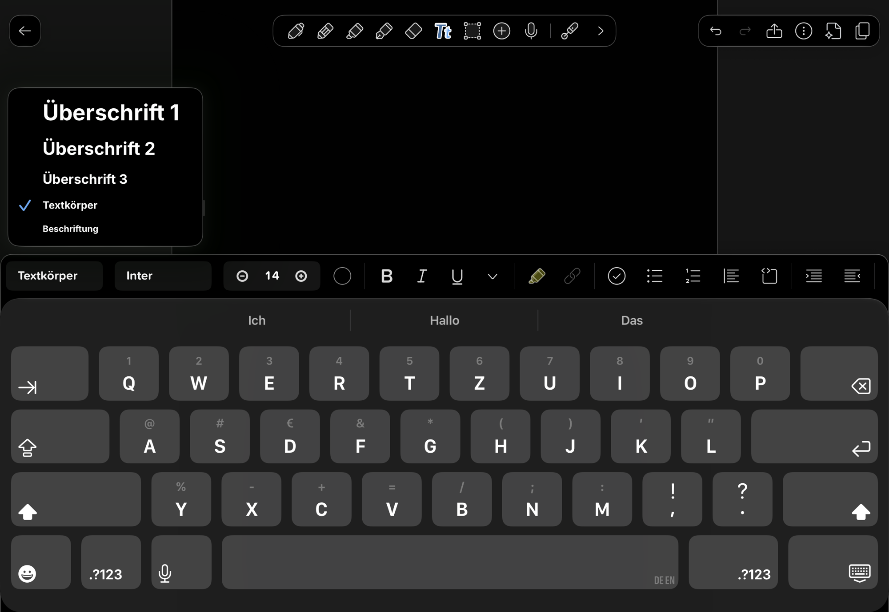
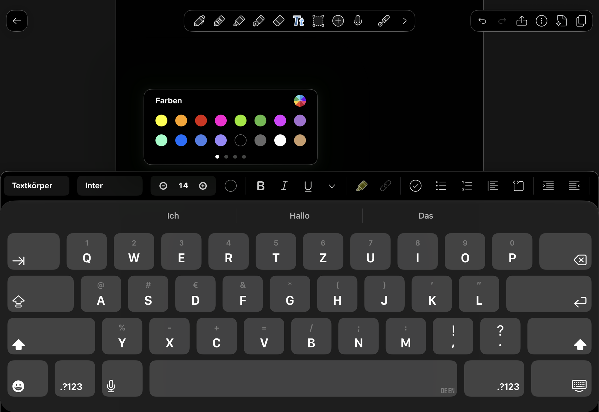
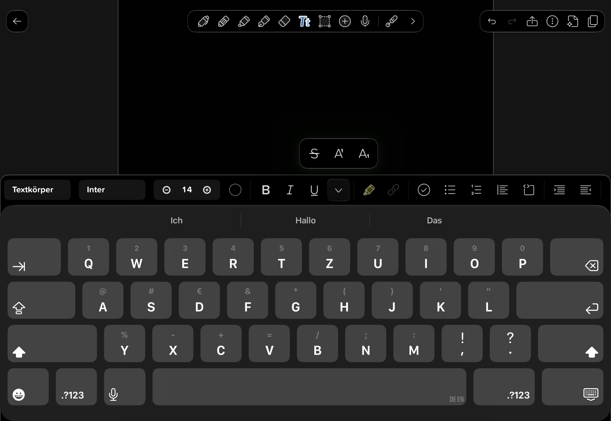
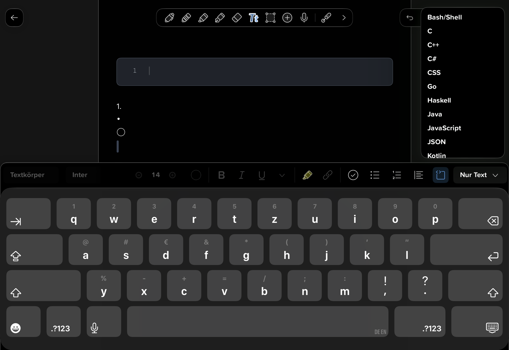

# Texteditor und zusätzliche Schreibseite – Build 27

## Bestätigtes Ziel

18.10.2026: Nutzer meldet Seitensprünge und eine helle Tastatur beim Tippen. Neue Referenzen IMG_0248–0251 zeigen eine dunkle Tastatur mit einer einzelnen Formatierungszeile sowie Menüs für Absatzstil, Schrift, Farbe und weitere Formate. PDF: freie schwebende Textfelder. Papier und zusätzlicher PDF-Schreibraum: Schreiben wie auf einer Seite ohne Feldleisten. Rückfrage ausdrücklich beantwortet: Text soll automatisch auf der nächsten Seite weiterlaufen.

Ergänzend eine stets bereitstehende leere Schreibseite unten, solange unbenutzt außerhalb von Seitenzahl, Heftdaten, Backup und PDF. Auch der erste Pencil-Strich macht daraus eine echte Seite; darunter wieder eine leere Schreibseite. Absichtlich angelegte oder bereits beschriebene echte Seiten werden nicht automatisch gelöscht, auch wenn ihr Text später leer wird.

## Umsetzung

- Tippen auf eine PDF-Fläche erzeugt ein freies Feld an der angetippten Position mit anfangs höchstens 260 pt Breite; vorhandene Felder weiter bearbeiten. Ausgewählte PDF-Felder behalten kompakte Verschiebe-/Breiten-/Löschgriffe mit 44-pt-Treffflächen in Bildschirmgröße.
- Auf Papier ein Textbereich mit 16-pt-Innenabstand und Seitenbreite. Jeder ausreichend große linke/rechte/obere/untere PDF-Schreibraum hat einen eigenen Anfang. Keine Rahmen oder Griffleisten für diese Textbereiche. Wiederholtes Antippen nutzt den bestehenden Bereich. Alte Texte behalten ihre Glyphpositionen; erst explizites Bearbeiten von Papier-/Randtext verknüpft ihn mit einem Textfluss und erweitert den verfügbaren Platz nach unten.
- Überlauf wird mit dem gemeinsamen nativen TextKit-Glyphlayout in vollständigen visuellen Zeilen aufgeteilt. Zusammengesetzte Unicode-Zeichen bleiben zusammen; UTF-16-Runs samt Grundstil in Run-Lücken bleiben erhalten. Text fließt in vorhandene verknüpfte Folgefelder, ansonsten auf eine geeignete unbenutzte Folgeseite oder eine neue Schreibseite. Hinter einem PDF-Rand bevorzugt passenden nächsten Rand; fehlt er, normale Papierseite. PDF-Quellen und andere Ebenen nicht verändern. Kürzen zieht Text zurück; keine bestehende Seite automatisch löschen.
- Fokusübergabe enthält Seiten-/Feld-ID, Auswahl und Einfügestil. Rücktaste am Anfang einer Fortsetzung verbindet mit dem vorigen Textabschnitt. Ganze mehrseitige Texteingriffe erhalten gemeinsame begrenzte Undo-/Redo-Schritte. Erwartete vollständige Heftstände verhindern, dass Text-Undo zwischenzeitliche Handschrift/Bilder/Restore überschreibt. Native Textauswahl bleibt je Feld/Seite; eine über mehrere native Felder gezogene Auswahl ist nicht implementiert.
- Dunkle Tastatur unabhängig vom bewusst hellen PDF-Renderer; Texteditor und Accessory explizit dunkel. Einheitliche 54-pt-Formatzeile direkt über der Tastatur, keine zweite dauerhafte Warnzeile und keine Text-Optionsleiste unter der Hauptleiste. Absatzstile Überschrift 1/2/3, Textkörper, Beschriftung; Schriftfamilien und native installierte Schriftwahl; Schriftgröße; 16 Farben plus Farbwähler; Fett/Kursiv/Unterstrichen; Durchstreichen/Hoch-/Tiefstellen; Markierung/Link; Aufgaben, Aufzählung/Nummerierung, Ausrichtung und Einzug. Die Referenz mit Code-Sprachwahl ist eine Gestaltungsreferenz; Syntaxhervorhebung und strukturierte Codeblöcke sind nicht Teil dieser Umsetzung. Installierte Schriften werden nach Namen gespeichert; fehlen sie auf einem anderen Gerät, Systemschrift als Fallback.
- Native UITextViews benutzen denselben TextKit-1-Aufbau wie Vorschau/PDF und scrollen nicht selbst. Normale Geometrie-/Autosaveupdates ersetzen weder View noch Textinhalt. IME-Komposition wird vor Reflow abgeschlossen. Der äußere Viewport bündelt Caret-Rückmeldungen, prüft aktiven Fokus und bewegt sich nur um den nötigen Abstand. Ein bereits sichtbarer Cursor bleibt stehen. Tastatur reserviert unten Sichtplatz, ohne einen neuen Breitenfit auszulösen; offscreen vorgehaltene Felder dürfen keine Seitensprünge auslösen. Expliziter Seitenwechsel beendet alten Textfokus.
- Die zusätzliche Seite existiert nur in den Editorseiten. Stabile ID bis zum ersten Text/Strich/Inhalt; Materialisierung und neue Reservefläche behalten die gerade bearbeitete native Fläche. Reines Anzeigen/Antippen eines leeren Textbereichs erzeugt keine Exportseite. Seitenzähler zeigt auf der Reserve „+“, die Gesamtzahl zählt echte Seiten. Automatischer Textüberlauf kann die vorbereitete Seiten-ID übernehmen.

## Speicherung und Prüfung

Notebook-Schema 8 ergänzt optionale `flowID`/`flowRegion` und optionale Stilfelder; bestehende Archiv-/Manifest-/Werkzeugformate bleiben gleich. Bestehende Daten erst bei einer tatsächlichen neuen Text-/Formatänderung migrieren; exakte bestätigte Altbytes vor dem Commit unter `Migrations` sichern. Alle Kopier-/Papierkorb-/Archivwege und unabhängige Pythonvalidierung berücksichtigen neue Felder. Die virtuelle Seite benötigt kein gespeichertes Flag und keine Exportfilterung. [STORAGE](../STORAGE.md).

219 Core-Tests und unabhängiger Schema-8-Heft-/Bibliotheksbackup-/Restore-Roundtrip bestanden. Signierter SDK-Build erfolgreich; Build 27 installiert und am Gerät bestätigt, alle 22 Hefte/152 Dateien unverändert zurückgelesen. Neue native Eingabe noch ungeprüft. Details, Installation und Bestandsvergleich: [TESTING](../TESTING.md). Die ursprünglichen Scrollfehler sind aus Quelltext als mögliche Rückkopplungen eingegrenzt; eine native Reproduktion mit Trace und eine erfolgreiche Geräteabnahme sind damit nicht behauptet.

## Gebündelter Gerätetest – noch offen

1. In einer Kopie eines mehrseitigen Hefts Papier, PDF und rechten Schreibraum testen. Cursor setzen, mehrere Zeilen und Umlaute/Emoji tippen, Text markieren und formatieren; Tastatur dunkel und Kopf stabil. Beim Tippen darf keine andere Seite gewählt werden; Tastatur öffnen/schließen, Sidebar und verschiedene Zoomstufen.
2. Genug Text einfügen, bis mindestens zwei Fortsetzungen entstehen. Weiter tippen, oben etwas löschen/formatieren, Rücktaste am Beginn der Fortsetzung, Undo/Redo und anschließend Ink prüfen. Kein Textverlust, keine doppelte Fortsetzung. Auch Blättermodus/gemischte Größen/normalisierte Anzeige.
3. Nur auf die Reserve scrollen: reale Seitenzahl/PDF/Backup bleiben gleich. Leeren Textbereich antippen, ohne zu tippen: ebenso. Erster Pencil-Strich bzw. erster Text erzeugt genau eine echte Seite und danach wieder eine Reserve. Speichern/Neustart, Seite im Export und editierbarem Backup unabhängig prüfen.
4. PDF-Feld an verschiedenen Positionen setzen, verschieben/verbreitern und gemischt formatieren. Alte Textpositionen/Handschrift/Original-PDF erhalten. Textfluss nach Schließen/Öffnen und externem Restore weiter bearbeiten.

## Quellen und Referenzen

Notability dokumentiert [direktes Schreiben, freie Textfelder und die Tastatur-Formatleiste](https://support.gingerlabs.com/en-us/articles/16300260-text-and-text-boxes). Der konkrete automatische Ausschluss der letzten leeren Fläche ist dort nicht eindeutig beschrieben; deshalb als Nutzeranforderung für Noty festgelegt, nicht als verifizierte aktuelle Exportgarantie von Notability ausgegeben. [Offizielle Export-Hilfe](https://support.gingerlabs.com/en-us/articles/16300163-sharing-notes). Öffentliche native Grundlagen: [Apple UITextView](https://developer.apple.com/documentation/uikit/uitextview), [Accessory](https://developer.apple.com/documentation/uikit/uitextview/inputaccessoryview), [gemeinsames Glyphlayout](https://developer.apple.com/documentation/uikit/nslayoutmanager).

